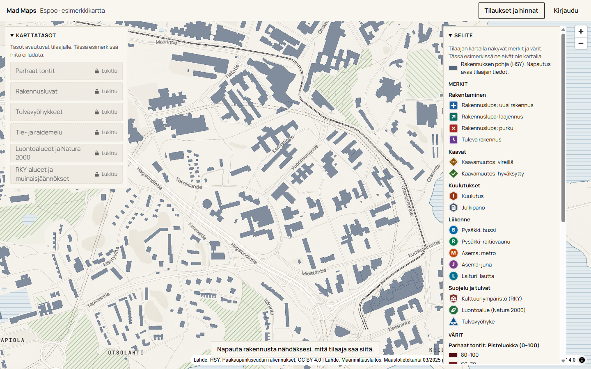

# Veeti Hietasalo

AI engineer, founder of Mad Tech Oy. Espoo, Finland.

[mad3d.ai](https://mad3d.ai) · [LinkedIn](https://www.linkedin.com/in/vvvhietasalo/) · [Email](mailto:veeti.hietasalo@gmail.com)

I take AI from prototype into daily use and measure whether it works. I build with coding agents: I set the direction, design the evaluations and check the measurements.

Open to AI/ML roles in Finland, Amsterdam, Stockholm and London. EU citizen. Mad Tech Oy is an NVIDIA Inception member.

## Mad 3D

Mad Maps is the main product: buildings, plots, zoning plans and building permits on one map, built from open public data. It is in closed beta, access by invitation. The [example map](https://maps.mad3d.ai/esimerkki) is open.

- On the map now: 151,173 buildings, 100,738 plots, 8,365 zoning plans and 158,794 building permits in Espoo, Helsinki, Vantaa and Kauniainen ([coverage file](https://maps.mad3d.ai/kattavuus.json), 2026-11-06).
- The assistant answers questions over this data. The model picks the facts and code does the arithmetic. An answer with a number that is not in the source facts is rejected before it reaches the user.
- Built with TypeScript, MapLibre GL, PMTiles, Postgres and Vercel. The assistant runs on the Anthropic API and is also served over MCP.

## MadMDL: a local coding model

MadMDL is my local coding agent: an own tool-use harness, a hidden-test eval suite run over several seeds, and a fine-tuning pipeline. The repo is private, demo on request.

Latest work is getting Qwen3.8-27B onto one RTX 5070 (12 GB). I derived a smaller MTP draft head for the 3-bit quant (requantized Q6_K to IQ4_XS) and patched only llama.cpp's CUDA backend (chunked dequantize, smaller cuBLAS workspace), so all 66 layers run on the card.

| What | Result |
| :--- | :--- |
| Serving | 14K context, all 66 layers on the GPU, 72 to 79 tok/s in the eval runs (43.6 tok/s without the draft head) |
| Eval, thinking low | 99/102 runs, 97.1% (34 tasks × 3 seeds) |
| Eval, thinking off | 92/102 runs, 90.2%, about 30% less wall-clock |
| Held-out tasks | 24/25 |
| Fine-tune | LoRA r=16 on a rented H200: 358 rows the model generated itself, 2 epochs, eval loss 0.226 |

Thinking off is 6.9 points lower (95% CI -14.4 to +0.1), which is inside the noise at 3 seeds.

[Demo of the harness (2:05)](https://github.com/veetihietasalo/veetihietasalo/blob/master/assets/madmdl_demo.mp4), a labelled replay of a logged run on an earlier model.

## Other projects

- [MiniHFT](https://github.com/veetihietasalo/MiniHFT): educational C++20. Replays a full NASDAQ ITCH 5.0 trading day (268.7M messages) into an order-by-order book in about 90 s. Lock-free queue at 50 ns median per hop, checked with ThreadSanitizer.
- [MonteCarloCpp](https://github.com/veetihietasalo/MonteCarloCpp): Monte Carlo option pricer in C++20, multithreaded, with a CUDA path.
- [OptionsPricing](https://github.com/veetihietasalo/OptionsPricing): Black-Scholes pricer with all five Greeks. TypeScript, Bun, Express and React.

## Skills

Python, TypeScript, C++20, SQL · PyTorch, LoRA fine-tuning, llama.cpp, eval design · React, Postgres, Vercel · Finnish (native), English (professional), Swedish (basic)
