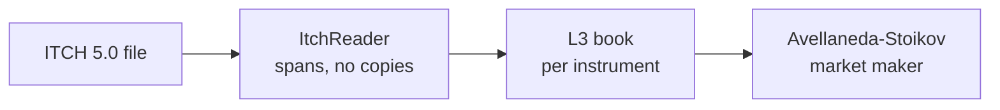

# Veeti Hietasalo

Low-latency C++, an operating system in Rust, and a coding agent that runs on a laptop. I run [Mad Tech Oy](https://mad3d.ai) in Espoo: real estate, planning and 3D data, built with a team that's mostly AI agents.

[LinkedIn](https://www.linkedin.com/in/vvvhietasalo/) · [mad3d.ai](https://mad3d.ai)

| Project | What it shows | Stack |
| :--- | :--- | :--- |
| [MiniHFT](https://github.com/veetihietasalo/MiniHFT) | A full NASDAQ day, 268.7M ITCH messages, through an L3 book in about 90 s. 50 ns p50 per hop between pinned threads[^bench] | C++20 |
| [MonteCarloCpp](https://github.com/veetihietasalo/MonteCarloCpp) | Option pricer, devirtualized and [measured on three compilers](https://github.com/veetihietasalo/MonteCarloCpp/blob/main/docs/devirtualization.md): 1 to 4% in the full pricer | C++20 |
| Rust OS | Framekernel: one small `unsafe` core, the rest `#![forbid(unsafe_code)]`. Preemptive threads on every core, runs in QEMU | Rust, private |
| Laptop coding agent | QLoRA-tuned 7B passes 38 of 60 hidden tests, the stock model 21 | Python, Ollama, private |

The market maker quotes around the reservation price $r = s - q\gamma\sigma^2(T-t)$. Over 1,000 runs of the paper's own simulation it makes 64.6 (std 6.6); the paper reports 65.0 (6.6).

> [!NOTE]
> Built to learn and measure, not for live trading.

More

- Open source: [Sigstore build provenance](https://github.com/superagent-ai/grok-cli/pull/271), [prerelease tags](https://github.com/superagent-ai/grok-cli/pull/268) and an [installer warning](https://github.com/superagent-ai/grok-cli/pull/269), merged in grok-cli
- Linux: Fedora 44 on bare metal, profiling with `perf`, `bpftrace` and `taskset`
- Claude Code for Windows Terminal: live mods, a plan-limit status line and a command guard, 750+ tests (private)
- Earlier: [OptionsPricing](https://github.com/veetihietasalo/OptionsPricing), [Finite-Element-Analysis](https://github.com/veetihietasalo/Finite-Element-Analysis), Spring Boot ([BookStore](https://github.com/veetihietasalo/BookStore)) and React apps ([carDealerShip](https://github.com/veetihietasalo/carDealerShip))

C++ · Rust · Python · TypeScript · Java · perf · bpftrace · CMake · ThreadSanitizer · QEMU · Miri · Kani · GitHub Actions

[^bench]: AMD Ryzen 9 9900X3D, Windows 11 and WSL2, about 10 ns of timer overhead included. Details in the [MiniHFT README](https://github.com/veetihietasalo/MiniHFT#-performance).
