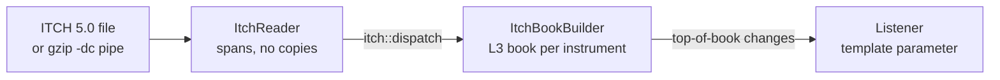

# Veeti Hietasalo

Nanosecond C++, an operating system in Rust, and a coding agent that runs on a laptop. I also run a company in Espoo where most of the team is AI agents.

[LinkedIn](https://www.linkedin.com/in/vvvhietasalo/) · [mad3d.ai](https://mad3d.ai)

| Project | What it is | Stack |
| :--- | :--- | :--- |
| [MiniHFT](#minihft) | Low-latency trading components, measured | C++20 |
| [Rust OS](#a-rust-operating-system) | An operating system from scratch | Rust |
| [Laptop coding agent](#a-coding-agent-on-a-laptop) | A coding agent on a 7B local model | Python, Ollama, QLoRA |
| [Terminal setup](#claude-code-for-windows-terminal) | Claude Code, tuned for Windows Terminal | TypeScript, Node.js |
| [MonteCarloCpp](#montecarlocpp) | Monte Carlo option pricer | C++20 |

## MiniHFT

A full NASDAQ trading day is 268.7 million messages. [MiniHFT](https://github.com/veetihietasalo/MiniHFT) replays every one of them through its own order book in about 90 seconds, decompression included.

It's the low-latency parts of a trading system, each built and measured on its own: a lock-free SPSC queue, an ITCH 5.0 reader, an order-by-order book and an Avellaneda-Stoikov market maker.

| What | Result[^bench] |
| :--- | :--- |
| One-way hop between two pinned threads, same CCD | 50 ns p50, 71 ns p99 |
| The same hop across CCDs | 171 to 180 ns p50 |
| Queue throughput, back-to-back | 6.5 to 7.0 ns per message, 150M msg/s |
| L3 order book update | 20 ns p50, flat from 10 to 1,000 resting orders per side |
| Heap allocations once warm | 0 in the queue and the ITCH to L3 book path |

What the measurements turned up:
- Doubling the cores cut p99 from 0.9 µs to 71 ns. The tail was the OS preempting the spinning threads, not the queue.
- Crossing CCDs adds about 125 ns per hop, because the cache line has to cross the I/O die.
- Publishing with a relaxed store instead of release damaged 0 of 10M messages on x86 and damaged messages on ARM. ThreadSanitizer flags the race on both, so CI runs it on both.
- Packing both indices onto one cache line took a back-to-back send from 7.0 to 13.4 ns.



The market maker quotes around the reservation price, with the paper's approximate optimal spread:

```math
r = s - q\gamma\sigma^2(T-t), \qquad \delta^a + \delta^b = \gamma\sigma^2(T-t) + \frac{2}{\gamma}\ln\left(1 + \frac{\gamma}{k}\right)
```

Rerunning the paper's own simulation over 1,000 runs gives the inventory strategy a profit of 64.6 with std 6.6. The paper has 65.0 and 6.6. Next: a native Linux baseline, then isolated cores, to see how much of the tail is left without the OS in the way.

> [!NOTE]
> Built to learn and measure, not for live trading.

## A Rust operating system

A security-first operating system in Rust, written from scratch: no Linux fork, no C kernel. It's a framekernel, so one small `unsafe` core is the whole trusted computing base and every other line of the kernel is `#![forbid(unsafe_code)]`. A memory-safety bug outside that core is a compile error. Private repo, pre-alpha, runs in QEMU.

<details>
<summary>What boots today</summary>

- [x] Limine boot on x86_64, stable Rust, `no_std`, no nightly
- [x] GDT, TSS, a 256-entry IDT, a live PIT clock, paging and a kernel heap
- [x] PS/2 keyboard, a lock screen and desktop, an interactive shell
- [x] An in-memory filesystem that persists to an IDE disk across reboots
- [x] e1000 networking with ARP, IPv4 and ICMP: it pings its gateway at boot
- [x] Preemptive kernel threads on every core, placed by a per-CPU scheduler and woken by IPI
- [x] int8 GEMM on scalar, AVX2, AVX-512 and VNNI, self-tested on each core at boot
- [x] Miri and Kani gate every change to the HAL in CI
- [ ] Component model and capabilities
- [ ] IOAPIC interrupt routing, an AMX inference tier, a windowed desktop

</details>

## A coding agent on a laptop

A coding agent that runs on a laptop in under 12 GB of RAM: a 7B open-weights model, a tool-use harness built around how small models fail, and hidden tests the agent never sees. Private repo.

The harness alone took the same 7B from 0 of the first 4 tasks to 8/10 with one retry. The changes that got it there: few-shot format anchoring, a tool-call parser that accepts the 4 formats 7B models drift between, edit errors that quote the closest file segment, and a gate that rejects "done" when files changed after the last passing command.

Then a QLoRA fine-tune on hidden-test-verified trajectories, distilled from Claude running the same harness. Rented A100, about $5 to 10 of GPU time:

| Hidden tests passed | Fine-tuned 7B | Stock 7B, same quant |
| :--- | :---: | :---: |
| All 60 tasks | **38** | 21 |
| 10 held-out tasks it never trained on | **4** | 2 |

The held-out set is small, so ±1 task is ±10 points and the +2 is a direction, not a precise number. Next is a bigger corpus and held-out set.

## Claude Code for Windows Terminal

Claude Code, tuned for Windows Terminal: live mods that draw inside Claude Code, a two-line status line with plan limits and cache hits, and a command guard that parses every Bash and PowerShell command in auto mode and blocks or asks before the risky ones. 750+ tests, 330+ of them on guard rules, 0 dependencies. Private repo.

## MonteCarloCpp

[MonteCarloCpp](https://github.com/veetihietasalo/MonteCarloCpp) prices European, Asian, barrier and lookback options, single and multi-threaded, with CI on GCC and MSVC. The pricer takes anything that satisfies the `EuropeanPayoff` concept, a lambda included:

```cpp
MonteCarloPricer pricer(100.0, 0.2, 0.05, 1.0);
auto result = pricer.price([](double s) { return std::max(s - 100.0, 0.0); }, 1'000'000);
```

A concrete payoff type is resolved at compile time, so the call can be inlined. Benchmarked against the old virtual call on three compilers, with the generated code read for each:

| Payoff call, 20M prices | Virtual | Template, lambda |
| :--- | ---: | ---: |
| MSVC 19.51, Windows | 1.11 ns | 0.43 ns |
| GCC 13.3, WSL2 | 5.43 ns | 0.38 ns |
| GCC 16.2, Fedora 44 on bare metal | 0.44 ns | 0.42 ns |

- GCC 13's 5.4 ns wasn't the call. It compiled `max(spot - strike, 0)` as a compare and branch, and with random prices that branch goes either way about half the time. GCC 16 compiles it branch-free with `cmpnltsd` + `andpd`.
- GCC 16 also devirtualizes speculatively: it compares the vtable pointer with the two payoffs in the program and runs an inlined copy on a match.
- In the whole pricer it barely matters. `perf record` on Fedora puts about 68% of the cycles in generating the normals and 14% in `exp()`, so devirtualizing saves 1 to 4%. Next is a branch-free normal transform.

Full write-up: [docs/devirtualization.md](https://github.com/veetihietasalo/MonteCarloCpp/blob/main/docs/devirtualization.md)

## Linux

My main machine runs Fedora 44 on bare metal, the upstream of the RHEL family: dnf, systemd, SELinux enforcing. What I've done on it:
- Set it up for performance work: the NVIDIA driver and CUDA from RPM Fusion akmods, GCC, Clang, mold and ccache, and perf, bpftrace, BCC, trace-cmd, numactl, hwloc, tuned, rt-tests and stress-ng. A sysctl drop-in lets `perf` read hardware counters and kernel symbols without root.
- Profiled MonteCarloCpp there with `perf stat`, `perf record` and `objdump`, pinned with `taskset`. The bare-metal GCC 16 numbers above come from that.
- hypr-terminal: a Hyprland look for the stock GNOME terminal (Ptyxis), a starship prompt and a Claude Code theme, the Fedora counterpart of the Windows Terminal setup above. It installs without sudo, backs up first, and checks every download against a pinned sha256. Not on GitHub yet.
- A systemd user timer that syncs the agent team's run data and the day's PR outcomes into our harness repo every night at 23:30, and catches up after the machine was off.
- Traced a crash storm, Firefox, Node and Bun all dying within 16 seconds, to a zram decompression failure in the kernel log, with `coredumpctl` and `journalctl`.

## Open source

| Repo | What | Status |
| :--- | :--- | :--- |
| [superagent-ai/grok-cli](https://github.com/superagent-ai/grok-cli) | [Sigstore build provenance for release binaries](https://github.com/superagent-ai/grok-cli/pull/271) | Merged |
| | [RC tags marked as GitHub prereleases](https://github.com/superagent-ai/grok-cli/pull/268) | Merged |
| | [Installer warns before picking a prerelease](https://github.com/superagent-ai/grok-cli/pull/269) | Merged |
| | [README section on every network endpoint](https://github.com/superagent-ai/grok-cli/pull/270) | Open |
| [vercel/vercel-plugin](https://github.com/vercel/vercel-plugin) | [Bug report: skill injection fires in non-Vercel projects](https://github.com/vercel/vercel-plugin/issues/98) | Open |

## Mad Tech Oy

At [Mad Tech Oy](https://mad3d.ai) we work in construction and real estate, and in data and AI engineering. Most of the team is AI: 63 agent roles across our repos, from a structural engineer and a sourcing manager to a kernel reviewer and a CFO. On 25 October 2026, 46 PRs were opened across our repos and 40 were merged. A change usually goes like this:


Those repos are private, so this is the only place it shows.

<details>
<summary>More projects</summary>

- [OptionsPricing](https://github.com/veetihietasalo/OptionsPricing): Black-Scholes pricer with Greeks and a price heatmap. Bun + Express API, React frontend.
- [Finite-Element-Analysis](https://github.com/veetihietasalo/Finite-Element-Analysis): finite element analysis in Python. Tetrahedral mesh, materials in SQLite, boundary conditions and forces, solves for node displacements.
- Gridfleet: a roguelite arena shooter in Godot where you win by arranging polyomino modules on your ship's grid, not by aiming. Early, private.
- Earlier work: Java back ends ([BookStore](https://github.com/veetihietasalo/BookStore), [Album-Store](https://github.com/veetihietasalo/Album-Store)) and JavaScript web and mobile apps.

</details>

| Languages | Tools |
| :--- | :--- |
| C++, Rust, Python, TypeScript, JavaScript, Java, Bash | Fedora / RHEL family, perf, bpftrace, CMake, GitHub Actions, ThreadSanitizer, QEMU, Miri, Kani, Ollama, React, Bun, Vercel |

[^bench]: AMD Ryzen 9 9900X3D, Windows 11 and WSL2. Every latency includes about 10 ns of timer overhead. Details and caveats in the [MiniHFT README](https://github.com/veetihietasalo/MiniHFT#-performance).
