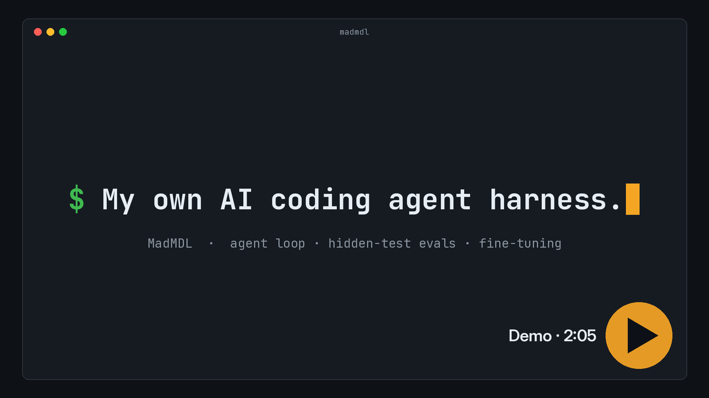
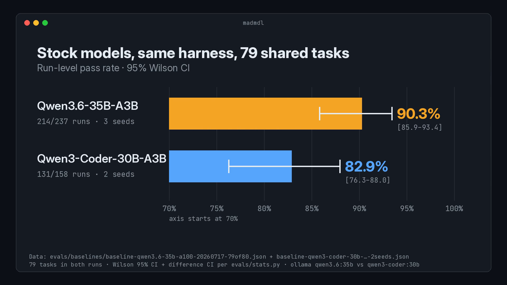
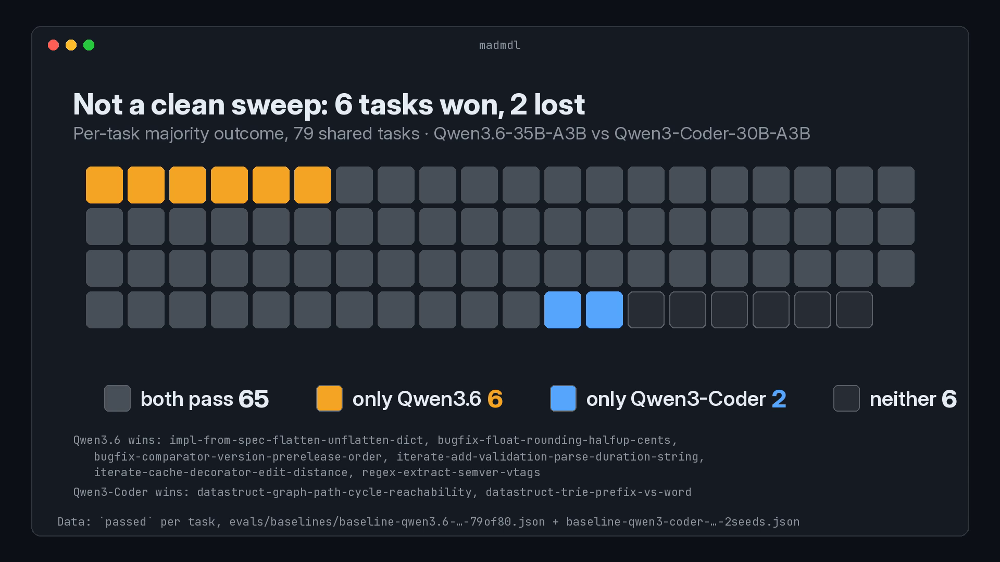
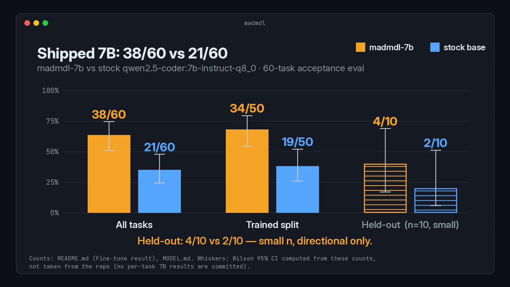

<!--
  DRAFT, not committed. Profile README for github.com/veetihietasalo/veetihietasalo.

  Contribution cards: for private work to show up, the GitHub setting
  Settings > Public profile > Contributions & activity > "Include private contributions on my profile"
  MUST be turned on. With it on, the streak card, the contribution calendar and the contributions badge count
  private contributions (as anonymous counts; no private repo names or code are exposed).
-->

# Hi, I'm Veeti Hietasalo 👋

**AI Engineer · LLM applications · Applied machine learning** · Espoo, Finland

-76B900?style=flat-square&logo=nvidia&logoColor=white)

AI engineer who takes AI from prototype into daily use and measures whether it works: LLM and RAG applications, open-weights coding models fine-tuned with LoRA / QLoRA (including mixture-of-experts), and valuation models with calibrated uncertainty.

I build with coding agents AND MYSELF: I set the direction, design the evaluations and check the measurements.

## 🧰 Skills

**Languages**

**AI / ML**

**Frameworks**

**Cloud & Data**

**Tools / DevOps**

  

**Spoken languages**

-006AA7?style=flat-square)

## 🎬 MadMDL demo

**MadMDL**: a local AI coding agent and fine-tuning pipeline. Own tool-use harness, a hidden-test eval suite run over several seeds with confidence intervals, and LoRA / QLoRA fine-tunes on verified agent trajectories.
▶️ [Watch the demo (2:05)](https://github.com/veetihietasalo/veetihietasalo/blob/master/assets/madmdl_demo.mp4)

*Demo segment is a labelled replay of a logged run; repo is private, demo on request.*

| Model | Setup | Result |
| :--- | :--- | :--- |
| Qwen3.6-35B-A3B (MoE) | 79 shared tasks × 3 seeds | **214/237 runs, 90.3%** |
| Qwen3-Coder-30B-A3B (MoE) | same 79 tasks × 2 seeds | 131/158 runs, 82.9% |
| **madmdl-7b**, QLoRA fine-tune of Qwen2.5-Coder-7B | 60-task acceptance suite vs. its base | **38/60 vs 21/60**; held out 4/10 vs 2/10 |

Qwen3.6-35B-A3B leads Qwen3-Coder-30B-A3B by **+7.4 points (95% CI +0.6 to +14.7)**. The 7B's held-out set is only 10 tasks, so that gain is directional.

*Qwen3.6-35B-A3B 90.3% vs Qwen3-Coder-30B-A3B 82.9%, Wilson 95% CIs.*

*Per-task outcome: 65 both pass, 6 only Qwen3.6, 2 only Qwen3-Coder, 6 neither.*

*madmdl-7b vs base: 38/60 vs 21/60, held-out 4/10 vs 2/10.*

## 🚀 Other projects

| | |
| :--- | :--- |
| [MiniHFT](https://github.com/veetihietasalo/MiniHFT) | Educational C++20: replays a full NASDAQ ITCH 5.0 trading day (268.7M messages) into an order-by-order book in about 90 s; lock-free queue at 50 ns median per hop, checked with ThreadSanitizer |
| [MonteCarloCpp](https://github.com/veetihietasalo/MonteCarloCpp) | Monte Carlo option pricer in C++20, multithreaded, with a CUDA path |
| [OptionsPricing](https://github.com/veetihietasalo/OptionsPricing) | Black-Scholes pricer with all five Greeks. TypeScript, Bun, Express and React |

## 📊 GitHub activity

<!-- Requires "Include private contributions on my profile" to be ON for private work to be counted. -->

### Contributions in the last year

&color=2EA44F&style=flat-square&logo=github)

Contribution count, calendar and streak include private contributions as anonymous counts when that setting is on.
